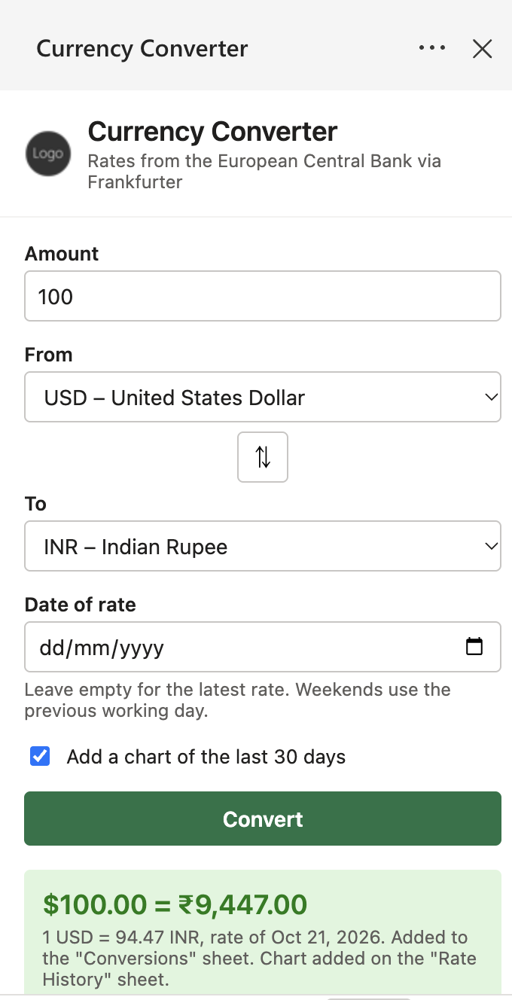
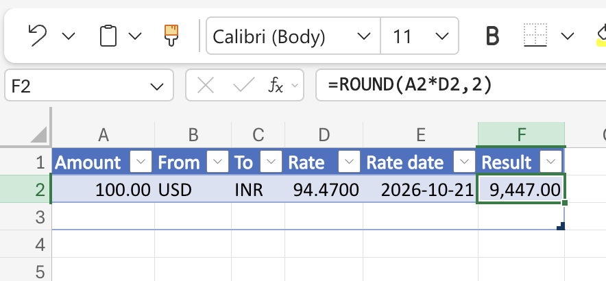
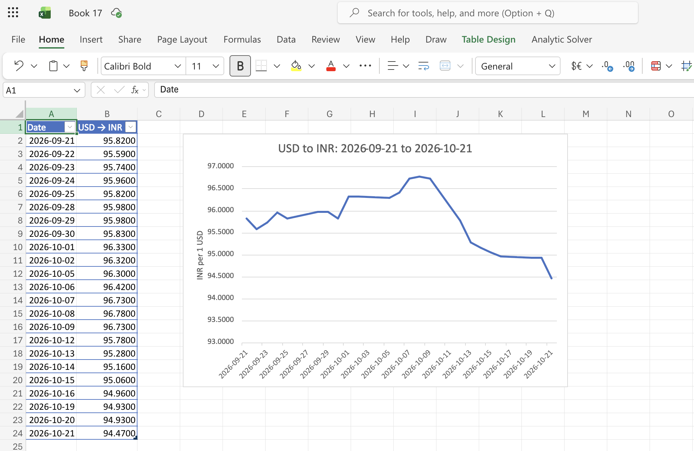
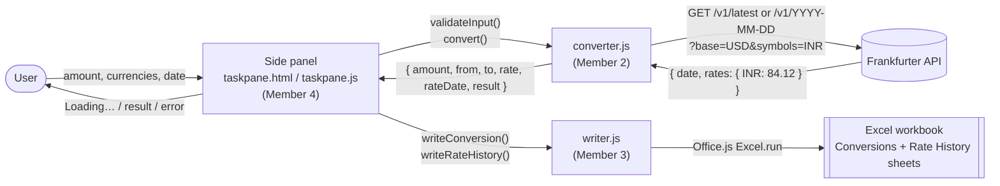

# Currency Converter - Excel Add-in

IMAP Group Project, Topic: *Excel Add-in that Fetches API Data*.

An Office task pane add-in for Excel. The user enters an amount and picks two currencies, and the add-in fetches the exchange rate from the Frankfurter API, calculates the converted amount, and writes the result with the rate and its date into the worksheet.

**Tech:** HTML, CSS and JavaScript task pane, Office.js, Frankfurter API (no API key), Node.js, webpack, Yeoman Office generator.



## How to use it

1. Run the add-in (see *How to run and sideload* under Member 1).
2. In Excel, go to the **Home** tab, **Currency** group, and click **Convert Currency**. The side panel opens.
3. Type an amount, choose the *From* and *To* currencies (⇅ swaps them), and optionally pick a date. Leave the date empty for the latest rate.
4. Click **Convert**. The panel shows "Loading…", then the result.

What appears in the workbook:

- **Conversions** sheet: one new table row per conversion with Amount, From, To, Rate, Rate date and Result. Result is a formula, `=ROUND(A2*D2,2)`, so it can be checked.
- **Rate History** sheet (if the chart box is ticked): the daily rate for the 30 days up to the rate date, and a line chart of it.

Notes:

- Rates come from the European Central Bank and are only published on working days. For a weekend or holiday the add-in uses the previous working day, and the *Rate date* column shows which day that was.
- Rates are available from 4 January 1999.




## How it works



| File | Owner | What it does |
| --- | --- | --- |
| `manifest.xml` | Member 1 | Add-in name, ribbon button, where the panel is loaded from |
| `src/currency/converter.js` | Member 2 | Calls the Frankfurter API, checks input, calculates amount × rate |
| `test/converter.test.mjs` | Member 2 | Tests for the conversion, the input checks and API error handling |
| `src/excel/writer.js` | Member 3 | Writes the conversion table, the formula, the rate history and the chart |
| `src/taskpane/taskpane.html`, `.css`, `.js` | Member 4 | The side panel and the Convert button logic |

## Running the tests

```bash
npm test
```

The tests use Node's built-in test runner (Node 20 or newer) and a fake `fetch`, so they don't need the internet or Excel.

---

## Member 1: Setup, Manifest and Sideloading (Gauri Deshmukh)

**Branches:** `feat/setup-manifest`, `docs/readme-setup`
**Files:** `manifest.xml`, `package.json`, `webpack.config.js`, `.gitignore`, `README.md`

### What I did

1. Created the GitHub repo, added the team as collaborators, and protected `main` with a ruleset (pull request and one approval required, no force pushes or deletion).
2. Generated the add-in with the Yeoman Office generator:

```bash
   npm install -g yo generator-office
   yo office
```

   Choices: Office Add-in Task Pane project, JavaScript, add-in only (XML) manifest, name "Currency Converter", Excel.
3. Added a `.gitignore` (`node_modules/`, `venv/`, `.env`, `*.pem`, `*.crt`).
4. Customised `manifest.xml`: display name, description, provider name, ribbon group ("Currency"), button label ("Convert Currency"), tooltip and get-started text. The add-in `Id` and the localhost addresses were left unchanged.
5. Checked the manifest with `npm run validate` and ran the add-in with `npm start`.
6. Pushed the scaffold and manifest through a pull request, and shared the sideloading steps with the team.

### How to run and sideload

**Desktop Excel**

```bash
npm install
npm start
```

This builds the add-in, starts the dev server on `https://localhost:3000`, and sideloads the add-in into Excel. Accept the certificate prompt if it appears. Stop it with `npm stop`.

**Excel on the web (fallback)**

1. Keep `npm start` running so the dev server is up.
2. In Excel on the web: Insert, Add-ins, Upload My Add-in.
3. Choose `manifest.xml` from the project folder.

**Troubleshooting**

- Certificate error: run `npx office-addin-dev-certs install`, then restart Excel.
- Add-in not showing: close all Excel windows and run `npm start` again.
- Old version still showing: run `npm stop`, then `npm start`.

### Research answers

#### What are Office Add-ins and the manifest file?

_Write your answer here in your own words. Cover: what an Office Add-in is (a web app running inside an Office app, using Office.js); what the manifest is; its key parts (`Id`, `DisplayName`, `Hosts`, `SourceLocation`, `Permissions`, `VersionOverrides` for the ribbon button); and why we chose the add-in only XML manifest._

#### How do you sideload an add-in for testing?

_Write your answer here in your own words. Cover: what sideloading means; how `npm start` does it on desktop; how to upload the manifest on Excel on the web; and why HTTPS and a certificate are needed._

### Pull requests

- `feat/setup-manifest` to `main`: (add link)
- `docs/readme-setup` to `main`: (add link)

---

## Member 2: Exchange Rate and Conversion (Name)

**Branch:** `feat/rate-conversion`
**Files:** `src/currency/converter.js`, `test/converter.test.mjs`, `package.json` (`test` script)

### What I did

1. Wrote `fetchRate(from, to, date)`, which asks the Frankfurter API for the rate of 1 `from` in `to`. With no date it uses `/v1/latest`; with a date it uses `/v1/YYYY-MM-DD`. It returns the rate and the date the rate is really from.
2. Wrote `calculate(amount, rate)`: amount × rate, rounded to 2 decimal places (with a fix for floating-point cases like 1.005).
3. Wrote `validateInput()`, which catches: empty amount, text instead of a number, negative or zero amount, missing currency, the same currency twice, a future date, a date before 4 January 1999, and impossible dates like 30 February.
4. Turned every API problem (no internet, unknown currency, server error, unreadable answer) into a `ConversionError` with a message the panel can show as it is.
5. Added `fetchRateHistory()` for the chart and `fetchCurrencies()` for the dropdowns.
6. Wrote 33 tests with Node's built-in test runner. A fake `fetch` returns fixed answers, so the tests check the URLs we build and the maths without going online. Run them with `npm test`.

### Research answers

#### How does the Frankfurter API work?

_Write your answer here in your own words._

#### Why test with a fake fetch instead of the real API?

_Write your answer here in your own words._

### Pull requests

- `feat/rate-conversion` to `main`: (add link)

---

## Member 3: Writing to Excel (Name)

**Branch:** `feat/excel-output`
**Files:** `src/excel/writer.js`

### What I did

1. Wrote `writeConversion()`. The first time, it creates a **Conversions** sheet and a table named `ConversionTable` with the headers Amount, From, To, Rate, Rate date and Result. After that, each conversion adds one row to the bottom of the table.
2. Made the Result cell a formula, `=ROUND(A2*D2,2)` (amount × rate), instead of a fixed number, so anyone can click it and check the maths.
3. Formatted the table: table style, bold headers, `#,##0.00` for money, `0.0000` for the rate, `yyyy-mm-dd` for the date, auto-fit columns. The new row is selected so the user sees it.
4. Wrote `writeRateHistory()`, which fills a **Rate History** sheet with the daily rate for the last 30 days and adds a line chart with a title and axis label. The sheet is cleared each time, so it always shows the latest pair.

### Research answers

#### How does `Excel.run` and `context.sync()` work?

_Write your answer here in your own words._

#### Why write the result as a formula?

_Write your answer here in your own words._

### Pull requests

- `feat/excel-output` to `main`: (add link)

---

## Member 4: Side Panel, Testing and Report (Name)

**Branches:** `feat/taskpane-ui`, `docs/readme-report`
**Files:** `src/taskpane/taskpane.html`, `src/taskpane/taskpane.css`, `src/taskpane/taskpane.js`, `README.md`, `docs/screenshots/`

### What I did

1. Replaced the template welcome page with the converter panel: amount box, From and To dropdowns with a swap button, date picker (limited to 4 Jan 1999 to today), a chart checkbox and a Convert button.
2. Filled the dropdowns from the API's currency list, with a built-in list as a backup if the API can't be reached.
3. Connected the Convert button: check the input (Member 2's `validateInput`), get the rate and result (`convert`), write it to the sheet (Member 3's `writeConversion`), then add the chart (`fetchRateHistory` and `writeRateHistory`).
4. While working, the button shows "Loading…" and the panel says which step is running. Errors appear in a red box; the result appears in a green box. If only the chart fails, the conversion is still kept.
5. Took the screenshots, drew the diagram above, wrote this README, and tested the whole add-in using the checklist below.

### Test checklist

| # | Test | Expected | Result |
| --- | --- | --- | --- |
| 1 | 100 USD to INR, no date | Row added, Result formula = Amount × Rate | |
| 2 | 100 EUR to GBP on a past weekday | Rate date = that day | |
| 3 | Same, on a Sunday | Rate date = the Friday before | |
| 4 | Empty amount | "Please enter an amount." | |
| 5 | Amount -5 | "The amount cannot be negative." | |
| 6 | Amount "abc" | "The amount must be a number." | |
| 7 | USD to USD | "Choose two different currencies." | |
| 8 | Wi-Fi off, click Convert | "Could not reach the exchange-rate service…" | |
| 9 | Second and third conversion | New rows added below, formulas point at their own row | |
| 10 | Chart box ticked | Rate History sheet with a line chart | |
| 11 | Editing a cell, then Convert | "Excel is busy editing a cell…" | |
| 12 | `npm test` | All tests pass | |

### Research answers

#### How does the task pane talk to Excel and to the web?

_Write your answer here in your own words._

### Pull requests

- `feat/taskpane-ui` to `main`: (add link)
- `docs/readme-report` to `main`: (add link)
