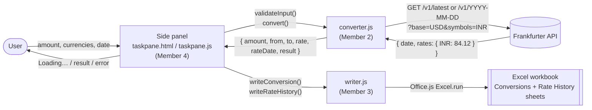

# Currency Converter - Excel Add-in

IMAP Group Project, Topic: *Excel Add-in that Fetches API Data*.

An Office task pane add-in for Excel. The user enters an amount and picks two currencies, and the add-in fetches the exchange rate from the Frankfurter API, calculates the converted amount, and writes the result with the rate and its date into the worksheet.

**Tech:** HTML, CSS and JavaScript task pane, Office.js, Frankfurter API (no API key), Node.js, webpack, Yeoman Office generator.


## How to use it

1. Run the add-in (see *How to run and sideload* under Member 1).
2. In Excel, go to the **Home** tab, **Currency** group, and click **Convert Currency**. The side panel opens.
3. Type an amount, choose the *From* and *To* currencies (⇅ swaps them), and optionally pick a date. Leave the date empty for the latest rate.
4. Click **Convert**. The panel shows "Loading…", then the result.

What appears in the workbook:

- **Conversions** sheet: one new table row per conversion with Amount, From, To, Rate, Rate date and Result. Result is a formula, `=ROUND(A2*D2,2)`, so it can be checked.
- **Rate History** sheet (if the chart box is ticked): the daily rate for the 30 days up to the rate date, and a line chart of it.

Notes:

- Rates come from the European Central Bank and are only published on working days. For a weekend or holiday the add-in uses the previous working day, and the *Rate date* column shows which day that was.
- Rates are available from 4 January 1999.


## How it works



All project files are inside the `Currency Converter` folder.

| File | Owner | What it does |
| --- | --- | --- |
| `manifest.xml` | Member 1 | Add-in name, ribbon button, where the panel is loaded from |
| `src/currency/converter.js` | Member 2 | Calls the Frankfurter API, checks input, calculates amount × rate |
| `test/converter.test.mjs` | Member 2 | Tests for the conversion, the input checks and API error handling |
| `src/excel/writer.js` | Member 3 | Writes the conversion table, the formula, the rate history and the chart |
| `src/taskpane/taskpane.html`, `.css`, `.js` | Member 4 | The side panel and the Convert button logic |

## Running the tests

```bash
cd "Currency Converter"
npm test
```

The tests use Node's built-in test runner (Node 20 or newer) and a fake `fetch`, so they don't need the internet or Excel.

---

## Member 1: Setup, Manifest and Sideloading (Gauri Deshmukh)

**Branches:** `feat/setup-manifest`, `docs/readme-setup`
**Files:** `manifest.xml`, `package.json`, `webpack.config.js`, `.gitignore`, `README.md`

### What I did

1. Created the GitHub repo, added the team as collaborators, and protected `main` with a ruleset (pull request and one approval required, no force pushes or deletion).
2. Generated the add-in with the Yeoman Office generator:

```bash
   npm install -g yo generator-office
   yo office
```

   Choices: Office Add-in Task Pane project, JavaScript, add-in only (XML) manifest, name "Currency Converter", Excel.
3. Added a `.gitignore` (`node_modules/`, `venv/`, `.env`, `*.pem`, `*.crt`).
4. Customised `manifest.xml`: display name, description, provider name, ribbon group ("Currency"), button label ("Convert Currency"), tooltip and get-started text. The add-in `Id` and the localhost addresses were left unchanged.
5. Checked the manifest with `npm run validate` and ran the add-in with `npm start`.
6. Pushed the scaffold and manifest through a pull request, and shared the sideloading steps with the team.

### How to run and sideload

**Desktop Excel**

```bash
cd "Currency Converter"
npm install
npm start
```

This builds the add-in, starts the dev server on `https://localhost:3000`, and sideloads the add-in into Excel. Accept the certificate prompt if it appears. Stop it with `npm stop`.

**Excel on the web (fallback)**

1. Keep `npm start` running so the dev server is up.
2. In Excel on the web: Insert, Add-ins, Upload My Add-in.
3. Choose `manifest.xml` from the project folder.

**Troubleshooting**

- Certificate error: run `npx office-addin-dev-certs install`, then restart Excel.
- Add-in not showing: close all Excel windows and run `npm start` again.
- Old version still showing: run `npm stop`, then `npm start`.

### Research answers

#### What are Office Add-ins and the manifest file?

An Office Add-in is a small web app (HTML, CSS and JavaScript) that runs inside an Office program such as Excel. It appears as a side panel (task pane) and talks to the open workbook through Microsoft's JavaScript library, Office.js. Because it is just a web page, the same add-in works in Excel on Windows, Mac and the web.

The manifest (`manifest.xml`) tells Excel what the add-in is and where to find it. Its key parts are:

- `Id`: a unique ID (GUID) for the add-in.
- `DisplayName` and `Description`: the name and text the user sees.
- `Hosts`: which Office apps it runs in; for us, `Workbook` (Excel).
- `SourceLocation`: the web address of the task pane page (`https://localhost:3000/taskpane.html` while developing).
- `Permissions`: what the add-in may do with the document; we use `ReadWriteDocument` because we write to the sheet.
- `VersionOverrides`: adds the **Convert Currency** button in the **Currency** group on the Home tab.

We chose the add-in only XML manifest because it is what the Yeoman generator produces for Excel, it is supported by every version of Excel including Excel on the web, and it can be uploaded directly for testing without any extra setup.

#### How do you sideload an add-in for testing?

Sideloading means installing an add-in yourself for testing, without publishing it to the Microsoft store. Excel reads our manifest and loads the task pane from our own computer.

On desktop Excel, `npm start` does everything: it builds the code, starts the dev server on `https://localhost:3000`, registers the manifest with Excel and opens Excel with the add-in loaded. On Excel on the web, we keep the dev server running and upload `manifest.xml` through **Home → Add-ins → More Add-ins → My Add-ins → Upload My Add-in** (or **Manage your apps → Upload an app**).

Office only loads add-in pages over HTTPS, so the dev server needs a security certificate. `office-addin-dev-certs` creates a local certificate and marks it as trusted on the computer, so Excel and the browser accept `https://localhost`.

### Pull requests

- `feat/setup-manifest` to `main`: [#1](https://github.com/Gauri210/excel-currency-addin/pull/1)
- `docs/readme-setup` to `main`: [#2](https://github.com/Gauri210/excel-currency-addin/pull/2)

---

## Member 2: Exchange Rate and Conversion (Edlyn Mathias)

**Branch:** `feat/rate-conversion`
**Files:** `src/currency/converter.js`, `test/converter.test.mjs`, `package.json` (`test` script)

### What I did

1. Wrote `fetchRate(from, to, date)`, which asks the Frankfurter API for the rate of 1 `from` in `to`. With no date it uses `/v1/latest`; with a date it uses `/v1/YYYY-MM-DD`. It returns the rate and the date the rate is really from.
2. Wrote `calculate(amount, rate)`: amount × rate, rounded to 2 decimal places (with a fix for floating-point cases like 1.005).
3. Wrote `validateInput()`, which catches: empty amount, text instead of a number, negative or zero amount, missing currency, the same currency twice, a future date, a date before 4 January 1999, and impossible dates like 30 February.
4. Turned every API problem (no internet, unknown currency, server error, unreadable answer) into a `ConversionError` with a message the panel can show as it is.
5. Added `fetchRateHistory()` for the chart and `fetchCurrencies()` for the dropdowns.
6. Wrote 33 tests with Node's built-in test runner. A fake `fetch` returns fixed answers, so the tests check the URLs we build and the maths without going online. Run them with `npm test`.

### Research answers

#### How does the Frankfurter API work?

Frankfurter is a free, open-source web API that returns currency exchange rates published by the European Central Bank. It needs no API key and answers in JSON.

We use three requests:

- `/v1/latest?base=USD&symbols=INR` for the latest rate,
- `/v1/2024-03-15?base=USD&symbols=INR` for the rate on a past date,
- `/v1/2024-02-14..2024-03-15?base=USD&symbols=INR` for every rate between two dates (used for the chart),

plus `/v1/currencies` for the list of currency codes and names in the dropdowns.

A typical answer is `{"amount":1,"base":"USD","date":"2026-10-21","rates":{"INR":94.47}}`. The ECB only publishes rates on working days, so for a weekend or holiday the API returns the last working day's rate, and the `date` field tells us which day that was. Data starts on 4 January 1999.

#### Why test with a fake fetch instead of the real API?

The real API gives a different rate every day, so a test like "100 USD should be 8,412 INR" would fail tomorrow. The tests would also need the internet and would break if the API was slow or down.

Instead, each test passes a fake `fetch` function that returns a fixed answer we choose. This lets us check exactly what we care about: that we build the right URL, that amount × rate is calculated and rounded correctly, and that errors (unknown currency, server error, no internet) give the right message. The tests are fast, always give the same result, and can test error cases that are hard to cause with the real API.

### Pull requests

- `feat/rate-conversion` to `main`: [#7](https://github.com/Gauri210/excel-currency-addin/pull/7)

---

## Member 3: Writing to Excel (Aabha Karle)

**Branch:** `feat/excel-output`
**Files:** `src/excel/writer.js`

### What I did

1. Wrote `writeConversion()`. The first time, it creates a **Conversions** sheet and a table named `ConversionTable` with the headers Amount, From, To, Rate, Rate date and Result. After that, each conversion adds one row to the bottom of the table.
2. Made the Result cell a formula, `=ROUND(A2*D2,2)` (amount × rate), instead of a fixed number, so anyone can click it and check the maths.
3. Formatted the table: table style, bold headers, `#,##0.00` for money, `0.0000` for the rate, `yyyy-mm-dd` for the date, auto-fit columns. The new row is selected so the user sees it.
4. Wrote `writeRateHistory()`, which fills a **Rate History** sheet with the daily rate for the last 30 days and adds a line chart with a title and axis label. The sheet is cleared each time, so it always shows the latest pair.

### Research answers

#### How does `Excel.run` and `context.sync()` work?

`Excel.run` gives us a `context`, which is our connection to the open workbook. Inside it we work with proxy objects (sheets, ranges, tables, charts) that stand for things in Excel. Setting a value or calling a method on them does not change Excel straight away; the commands are queued.

`context.sync()` sends all the queued commands to Excel in one batch and waits for them to finish. It also fills in any properties we asked for with `load()`, for example a range's `address`. Batching like this matters because Excel can be on another machine (Excel on the web), so one round trip for many changes is much faster than one per change.

In `writer.js` we sync once to check whether the Conversions sheet and table already exist (`getItemOrNullObject` plus `isNullObject`), then queue all the writes and formatting, and sync again at the end.

#### Why write the result as a formula?

If we wrote the result as a plain number, nobody could see how it was worked out. Writing `=ROUND(A2*D2,2)` makes the calculation visible: clicking the Result cell shows that it is Amount (column A) × Rate (column D), rounded to 2 decimals, so anyone can check it.

It also keeps the sheet consistent: if someone edits the amount or the rate, Excel recalculates the result automatically. And it means the result in Excel is calculated by Excel itself, independently of our JavaScript, which is a good cross-check that the conversion is right.

### Pull requests

- `feat/excel-output` to `main`: [#8](https://github.com/Gauri210/excel-currency-addin/pull/8)

---

## Member 4: Side Panel, Testing and Report (Rudra Maharao)

**Branch:** `feat/taskpane-ui`
**Files:** `src/taskpane/taskpane.html`, `src/taskpane/taskpane.css`, `src/taskpane/taskpane.js`, `README.md` (repo root), `docs/screenshots/`, `.gitignore`

### What I did

1. Replaced the template welcome page with the converter panel: amount box, From and To dropdowns with a swap button, date picker (limited to 4 Jan 1999 to today), a chart checkbox and a Convert button.
2. Filled the dropdowns from the API's currency list, with a built-in list as a backup if the API can't be reached.
3. Connected the Convert button: check the input (Member 2's `validateInput`), get the rate and result (`convert`), write it to the sheet (Member 3's `writeConversion`), then add the chart (`fetchRateHistory` and `writeRateHistory`).
4. While working, the button shows "Loading…" and the panel says which step is running. Errors appear in a red box; the result appears in a green box. If only the chart fails, the conversion is still kept.
5. Took the screenshots, drew the diagram above, wrote this README, and tested the whole add-in using the checklist below.

### Test checklist

| # | Test | Expected | Result |
| --- | --- | --- | --- |
| 1 | 100 USD to INR, no date | Row added, Result formula = Amount × Rate | Pass |
| 2 | 100 EUR to GBP on a past weekday | Rate date = that day | Pass |
| 3 | Same, on a Sunday | Rate date = the Friday before | Pass |
| 4 | Empty amount | "Please enter an amount." | Pass |
| 5 | Amount -5 | "The amount cannot be negative." | Pass |
| 6 | Amount "abc" | "The amount must be a number." | Pass |
| 7 | USD to USD | "Choose two different currencies." | Pass |
| 8 | Wi-Fi off, click Convert | "Could not reach the exchange-rate service…" | Pass |
| 9 | Second and third conversion | New rows added below, formulas point at their own row | Pass |
| 10 | Chart box ticked | Rate History sheet with a line chart | Pass |
| 11 | Editing a cell, then Convert | "Excel is busy editing a cell…" | Pass |
| 12 | `npm test` | All tests pass | Pass (33/33) |

### Research answers

#### How does the task pane talk to Excel and to the web?

The task pane is a web page running inside Excel, so it talks in two directions.

**To the web:** it uses the browser's `fetch` function to call the Frankfurter API over HTTPS and gets back JSON with the rate (`converter.js`).

**To Excel:** it uses Office.js. `Office.onReady` tells us when Excel has loaded the panel, and `Excel.run` with `context.sync()` lets us read and write the workbook: creating the sheets, adding table rows, writing the formula and drawing the chart (`writer.js`).

`taskpane.js` connects the two. When Convert is clicked it checks the input, fetches the rate, writes the row to Excel, adds the rate history chart, and shows "Loading…", an error, or the result in the panel.

### Pull requests

- `feat/taskpane-ui` to `main`: [#9](https://github.com/Gauri210/excel-currency-addin/pull/9)
